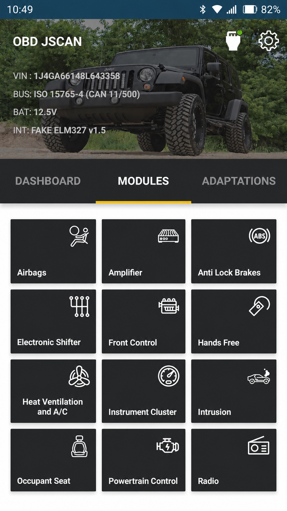
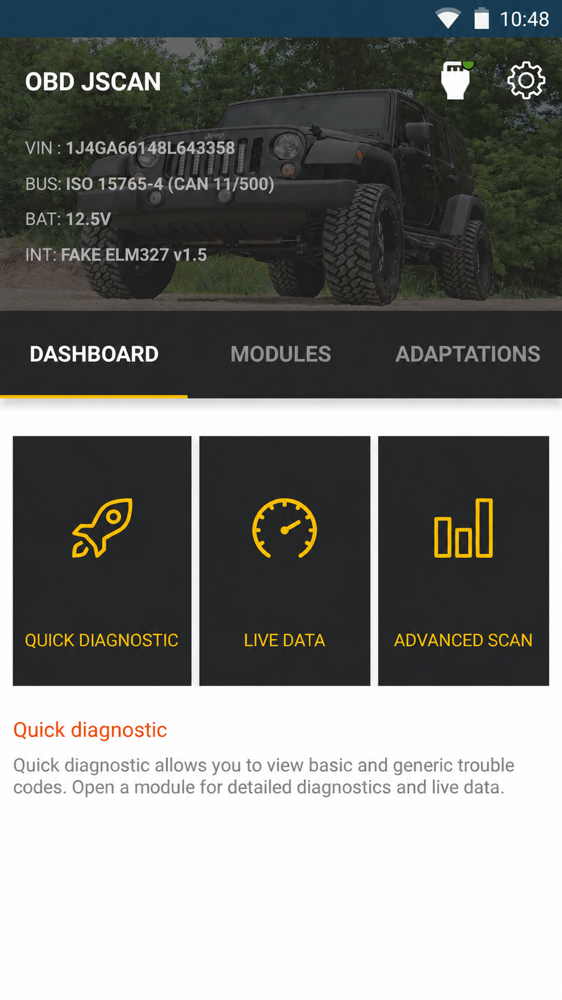
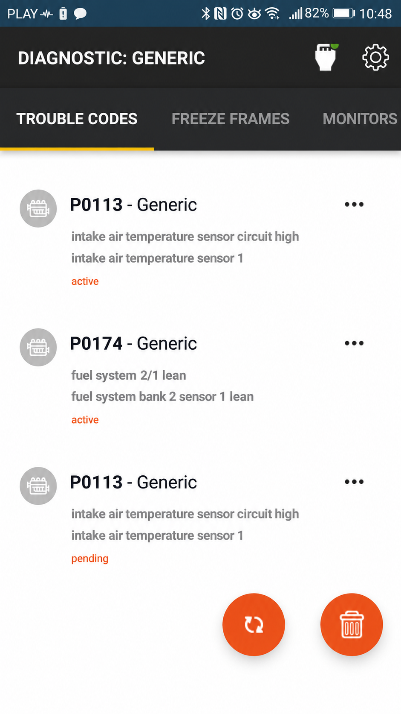

# OBD JScan Jeep Settings - Jeep Diagnostics And Configuration Reference

## Project Description

OBD JScan is a diagnostic and configuration application for supported Jeep, Chrysler, Dodge, and RAM vehicles. It connects through a compatible Bluetooth or Wi-Fi OBD-II adapter to read vehicle modules, monitor sensor data, clear faults, and change supported factory settings.

OBD JScan Jeep Settings documents the communication architecture behind these workflows. The retained Python source includes ELM327 communication, ECU discovery, DoIP, USB-CAN support, parameter handling, data editors, command macros, and a graphical interface.

### What is JScan for Jeep?

JScan Jeep is a mobile diagnostics and configuration solution designed for supported Jeep and related FCA vehicles. It can read and clear diagnostic trouble codes, display OBD JScan live data, identify control modules, and expose supported factory configuration options that ordinarily require specialized equipment.

A typical setup consists of the mobile application, an OBD JScan compatible adapter, and the vehicle. Many 2018-or-newer vehicles also require an OBD JScan security bypass cable because the Security Gateway restricts programming access. JScan Jeep programming should only be performed after confirming vehicle, model year, adapter, and gateway requirements.

## Warnings

> Vehicle configuration changes can affect braking, steering, lighting, security, powertrain, and other safety-critical systems.

- Use OBD JScan Jeep Settings only on a vehicle that you own or are authorized to service.
- Record the original configuration before changing any JScan Jeep settings.
- Maintain stable battery voltage during diagnostics and programming.
- Change one setting at a time and verify the result before continuing.
- Do not interrupt an active write operation or disconnect the adapter.
- Avoid inexpensive generic ELM327 v2.1 clones because unstable connections can corrupt a programming session.
- Treat Security Gateway access as a safety control, not merely as an inconvenience.
- Use expert functions only when you understand the relevant ECU and CAN network.

## Features

- Read OBD JScan trouble codes from supported vehicle modules.
- Perform OBD JScan clear codes operations after diagnosing the underlying fault.
- Monitor OBD JScan live data such as temperatures, pressures, speeds, voltages, and sensor states.
- Discover ECUs and inspect module identification data.
- Support ELM327-style serial communication, DoIP, and selected USB-CAN interfaces.
- Provide parameter editors, request editors, ECU scanning, and command lookup.
- Document JScan Jeep JK tire size and JScan Jeep JL tire size configuration workflows.
- Cover research areas such as JScan Jeep JK fan control and JScan Jeep JL features.
- Preserve extensible command and plugin architecture for diagnostic research.
- Provide connection, command, customization, and troubleshooting documentation.

## Vehicle And Diagnostic Coverage

jscan jeep, jscan jeep wrangler, jscan jeep jk, jscan jeep jl, jscan jeep gladiator, obd-jscan, jeep-diagnostics, obd2, vehicle-diagnostics, automotive-diagnostics, ecu-configuration, elm327, jeep-wrangler

Vehicle support varies by model year, powertrain, installed modules, adapter capabilities, and application version. Common searches include Jeep JK JScan, OBD JScan Jeep JK, OBD JScan JK, JScan Jeep JT, Jeep Gladiator JScan, JScan Jeep Grand Cherokee WK2, JScan Jeep WK2, JScan Jeep Cherokee, JScan Jeep Compass, JScan Jeep Renegade, and JScan RAM 1500.

### Is JScan worth it?

JScan Jeep can be worthwhile for owners who need more than a generic emissions-code reader. Its value is strongest when tire-size changes, module diagnostics, live sensor monitoring, feature configuration, or repeated fault-code work would otherwise require dealer visits.

The total cost includes the OBD JScan VIN license, a dependable adapter, and possibly an OBD JScan SGW bypass. Owners who only need a single emissions-code scan may not need its deeper capabilities. Owners who maintain or customize a supported vehicle can often benefit from the broader module access and reusable diagnostic workflow.

## Supported Devices

| Device | Connection | Position | Notes |
|---|---|---|---|
| OBDLink MX+ | Bluetooth LE | Premium | OBD JScan OBDLink MX Plus is a strong general-purpose choice for iOS and Android. |
| vLinker MC+ | Bluetooth | Recommended | OBD JScan vLinker MC Plus offers reliable communication for supported vehicles. |
| iCar Pro 4.0 | Bluetooth LE | Value | OBD JScan iCar Pro 4.0 is a practical lower-cost option. |
| Compatible Wi-Fi adapter | Wi-Fi | Alternative | Useful when Bluetooth is unavailable, but network configuration must be correct. |
| Generic ELM327 v2.1 clone | Varies | Avoid | Clone quality is inconsistent and dropped connections are common. |

| Vehicle family | Common designation | Gateway consideration |
|---|---|---|
| Jeep Wrangler | JK | Earlier vehicles generally do not use the newer FCA Security Gateway. |
| Jeep Wrangler | JL | Many 2018-or-newer vehicles require authorized gateway access or a bypass cable. |
| Jeep Gladiator | JT | JScan Jeep Gladiator workflows commonly require Security Gateway preparation. |
| Jeep Grand Cherokee | WK2 | Exact support depends on model year and installed modules. |
| Jeep Cherokee, Compass, and Renegade | Various | Confirm the exact vehicle profile before connecting. |
| RAM 1500 | Various | Confirm platform and model-year support inside OBD JScan. |

### What is the best OBD reader for a Jeep?

There is no single best adapter for every Jeep, phone, and budget. For a broadly compatible premium setup, OBD JScan OBDLink MX Plus is the strongest choice from the researched adapters. OBD JScan vLinker MC Plus is another recommended option, while OBD JScan iCar Pro 4.0 provides a practical value-oriented Bluetooth LE choice.

The best OBD reader must also match the phone platform, vehicle generation, and intended operation. A stable adapter is especially important for JScan Jeep programming because a connection failure during a write is more serious than a dropped live-data sample. Cheap ELM327 v2.1 clones should not be selected for configuration work.

### Connection Methods

- **Bluetooth LE** — Recommended for convenient mobile diagnostics.
- **Bluetooth Classic** — Supported by appropriate Android devices and adapters.
- **Wi-Fi** — Available for compatible network adapters.
- **USB or USB-CAN** — Represented in the repository’s diagnostic reference implementation.
- **DoIP** — Implemented by the repository’s Diagnostics over IP modules.

See [Connections](docs/Connections.md) for transport concepts and [Troubleshooting](docs/Troubleshooting.md) for connection failures.

## Requirements

### Mobile Workflow

- A supported Jeep, Chrysler, Dodge, or RAM vehicle.
- The OBD JScan application on a compatible iOS or Android device.
- A reliable OBD JScan compatible adapter.
- An OBD JScan VIN license for full programming functions.
- An OBD JScan security bypass cable when required by the vehicle.
- A stable vehicle battery and uninterrupted phone power.

### Repository Reference

- Python 3.8 or newer.
- PyQt5 for the graphical interface.
- PySerial for ELM327 communication.
- PyUSB for supported USB devices.
- CRC and platform utility dependencies declared in [pyproject.toml](pyproject.toml).

### How much does JScan cost?

OBD JScan offers a demo mode for evaluating the interface and vehicle profiles. Full programming features generally require an OBD JScan VIN license, with the collected research placing the single-vehicle license at approximately $21. Current pricing can change and should be confirmed in the mobile application before purchase.

The OBD JScan license cost is not the entire hardware budget. A compatible adapter must be purchased separately, and supported 2018-or-newer vehicles may also require an SGW bypass cable. An OBD JScan VIN license is associated with one vehicle identification number rather than unlimited vehicles.

### Hardware Setup

1. Confirm the exact vehicle profile and model year.
2. Turn the ignition off before attaching cables.
3. Install the authorized Security Gateway bypass when the vehicle requires one.
4. Connect the adapter securely to the OBD-II port.
5. Turn the ignition to the application’s requested position without starting the engine unless instructed.
6. Pair or join the adapter using the correct Bluetooth or Wi-Fi method.
7. Select the matching vehicle profile and adapter in JScan Jeep.
8. Test module communication before changing any setting.
9. Save the original configuration before writing updates.

## Platform Notes

- **iOS** — Use an iOS-compatible Bluetooth LE or Wi-Fi adapter.
- **Android** — Bluetooth LE, supported Bluetooth Classic, and Wi-Fi options may be available.
- **2018 and newer FCA platforms** — Verify Security Gateway requirements before attempting configuration writes.

## Quick Start

1. Connect the recommended adapter and any required gateway cable.
2. Open JScan Jeep and select the exact vehicle.
3. Verify communication with a read-only module scan.
4. Review OBD JScan trouble codes before clearing anything.
5. Observe OBD JScan live data to validate the connection.
6. Back up the original configuration.
7. Apply one supported OBD JScan Jeep setting.
8. Cycle the ignition only when instructed.
9. Reconnect and confirm the new value.

## Plugin System

The retained source provides a Python plugin architecture under [`src/ddt4all/plugins/`](src/ddt4all/plugins/__init__.py). Command processing is implemented by [`cmd_macros.py`](src/ddt4all/plugins/cmd_macros.py), with CAN addressing in [`can_addressing.py`](src/ddt4all/plugins/cmd_macros_lib/can_addressing.py) and execution logic in [`cmd_engine.py`](src/ddt4all/plugins/cmd_macros_lib/cmd_engine.py).

Some bundled plugins are inherited vehicle-specific examples and are not Jeep presets. They demonstrate extension patterns only and must not be treated as validated JScan Jeep programming procedures.

## Architecture

### Core Modules

- [`main.py`](src/ddt4all/main.py) — Graphical entry point and connection coordination.
- [`options.py`](src/ddt4all/options.py) — Configuration and device-setting persistence.
- [`file_manager.py`](src/ddt4all/file_manager.py) — File and directory utilities.
- [`cli/`](src/ddt4all/cli/__init__.py) — Command-line parsing and transport handlers.

### Communication

- [`core/elm/`](src/ddt4all/core/elm/__init__.py) — ELM327 communication, ports, constants, and device detection.
- [`core/ecu/`](src/ddt4all/core/ecu/__init__.py) — ECU data, requests, identification, files, and scanning.
- [`core/doip/`](src/ddt4all/core/doip/__init__.py) — Diagnostics over IP connections and messages.
- [`core/usbdevice/`](src/ddt4all/core/usbdevice/__init__.py) — OBD and USB-CAN device support.

### User Interface

- [`main_window/`](src/ddt4all/ui/main_window/__init__.py) — Main diagnostic workspace and ECU lists.
- [`data_editor/`](src/ddt4all/ui/data_editor/__init__.py) — ECU parameter and request editing.
- [`parameters/`](src/ddt4all/ui/parameters/__init__.py) — Command and parameter widgets.
- [`sniffer/`](src/ddt4all/ui/sniffer/__init__.py) — Non-blocking network capture components.

## Testing

The repository includes automated Python validation through [`python-app.yml`](.github/workflows/python-app.yml) and syntax checks through [`python-syntax-checker.yml`](.github/workflows/python-syntax-checker.yml). Local test configuration is defined in [`tox.ini`](tox.ini).

Read-only testing should precede every vehicle write. Connection initialization, ECU discovery, request parsing, and adapter recovery should be verified without modifying vehicle configuration.

## Troubleshooting

### Adapter Does Not Connect

- Confirm that the adapter is powered and fully seated.
- Verify that the selected connection type matches the adapter.
- Remove competing applications connected to the same adapter.
- Try the documented adapter baud rate or network address.
- Replace unstable generic ELM327 clones.

### Modules Are Missing

- Confirm the exact vehicle profile.
- Check whether the Security Gateway blocks access.
- Verify that the ignition is in the required position.
- Confirm that the selected adapter supports the required bus.

### A Setting Does Not Change

- Confirm that the setting applies to the installed ECU.
- Restore the original value if module behavior becomes unexpected.
- Cycle the ignition only as directed.
- Re-read the module to verify that the write was accepted.
- Do not repeatedly write a rejected value.

### Communication Drops During A Write

- Stop further changes.
- Keep vehicle power stable.
- Reconnect using the same adapter and profile.
- Read the affected module before attempting recovery.
- Seek qualified assistance if the module no longer responds.

## Documentation & Videos

- [Documentation Index](docs/index.md)
- [Documentation](docs/Documentation.md)
- [Command Lookup](docs/Command%20Lookup.md)
- [Connections](docs/Connections.md)
- [Custom Commands](docs/Custom%20Commands.md)
- [Troubleshooting](docs/Troubleshooting.md)

## Contributing

Read [CONTRIBUTING.md](CONTRIBUTING.md) before proposing changes to OBD JScan Jeep Settings.

- Report reproducible connection or parsing defects with vehicle, model year, adapter, and platform details.
- Use the [bug report template](.github/ISSUE_TEMPLATE/bug_report.md) for defects.
- Use the [feature request template](.github/ISSUE_TEMPLATE/feature_request.md) for enhancements.
- Do not submit proprietary vehicle databases, license bypasses, secret keys, or unsafe programming instructions.
- Report security concerns according to [SECURITY.md](SECURITY.md).

## License

See [LICENSE](LICENSE).
